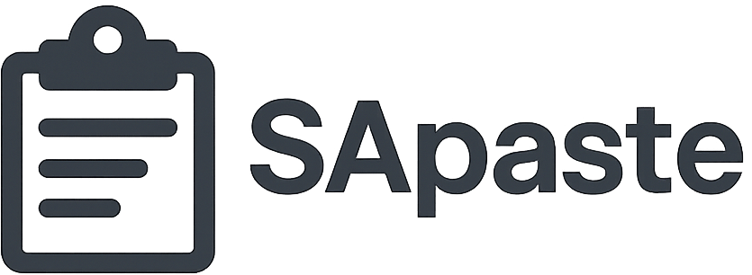
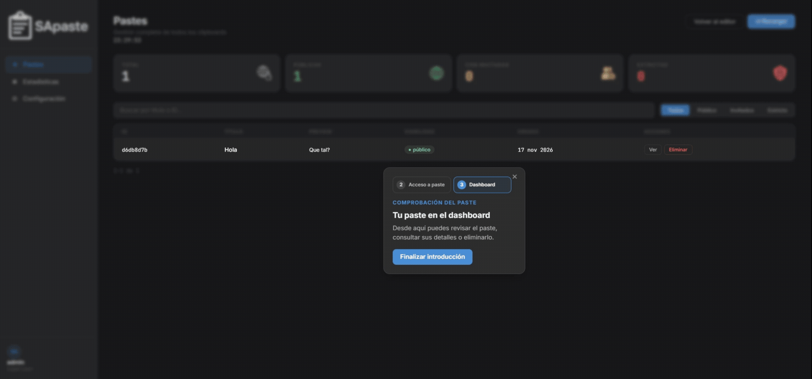

<div align="center">
    <picture>
      <source media="(prefers-color-scheme: dark)" srcset="docs/img/sapaste-logo-white.png">
      <source media="(prefers-color-scheme: light)" srcset="docs/img/sapaste-logo-dark.png">
      
      <br><br>
      <em>Clipboard online para crear, guardar y compartir textos con formato de forma rápida, sencilla y sin necesidad de registro.</em>
    </picture>
</div>

<br>
<br>

> **Nota sobre el estado actual del proyecto:** Servidor cerrado, consulta el apartado de [Simulación](#simulación).

---

## Tabla de contenidos

- [Contexto y función del proyecto](#contexto-y-objetivo-del-proyecto)
- [Simulacion y vistas](#simulacion-y-vistas)
- [Funcionalidades principales](#funcionalidades-principales)
- [Arquitectura original del sistema](#arquitectura-original-del-sistema)
- [Estructura de archivos (Frontend)](#estructura-de-archivos-frontend)
- [Mejoras y futuro del proyecto](#mejoras-y-futuro-del-proyecto)

---

## Contexto y objetivo del proyecto

### Contexto

**SApaste** es un proyecto realizado en 1º de DAM (Grado Superior de Desarrollo de Aplicaciones Multiplataforma) con la idea de integrar distintos campos dentro de una misma aplicación, como el diseño y desarrollo web, lógica de backend mediante una API, persistencia en base de datos y configuración de infraestructura.

Realmente la idea y el valor del proyecto mas allá del código, es que nos permitió trabajar en distintos ámbitos de sistemas y despliegue sobre **Proxmox**, donde se alojaron la API y la base de datos, junto con **Apache** para servir la web, una **CA mediante Nginx** y **DuckDNS** para gestionar el acceso y el **HTTPS**. La unión de todas estas piezas en un único proyecto me ayudó mucho a darme una visión muy práctica de cómo se conecta el frontend, el backend, la base de datos y la capa de red junto con los servidores en un entorno real.

### Objetivo

La **funionalidad** que ofrece **SApaste** es escribir o pegar un texto con formato, guardarlo y obtener una URL única (`https://sapaste.duckdns.org/p/{id}`) para compartirlo con cualquier persona sin instalar nada ni crear una cuenta. Está pensado para pasar configuraciones entre equipos, compartir fragmentos de código, notas rápidas o textos que deban conservar su formato.

Una pecurialidad es que cuenta con un sistema de **privacidad por niveles** que permite definir quién puede leer y quién puede editar cada paste.

---

## Simulacion y vistas

Debido al cierre del servidor donde se alojaban originalmente la API y la base de datos, el entorno en vivo cuenta con una **simulación** que reproduce el funcionamiento de la aplicación y sirve como introducción al proyecto.

<div align="center">

[](https://1oza16.github.io/sapaste/)

`https://1oza16.github.io/sapaste/`

</div>

### 1. Vista del paste

Representa la función principal de la aplicación: el editor de texto enriquecido donde escribir o pegar contenido, aplicar formato, guardar, compartir y probar el flujo del paste.

<div align="center">
  
  <br>
  <sub><em>Vista del paste: editor, formato de texto, guardado y opciones para compartir.</em></sub>
</div>

### 2. Vista del dashboard

Espacio de gestión al que solo pueden acceder los usuarios permitidos, pensado para administrar y supervisar los pastes desde una vista de control.

<div align="center">
  
  <br>
  <sub><em>Vista del dashboard: acceso restringido a usuarios permitidos y control de pastes.</em></sub>
</div>

### 
---

## Funcionalidades principales

### Editor de texto y atajos
* Editor enriquecido basado en `contenteditable` con soporte para negrita, cursiva y subrayado.
* Alineación de texto (izquierda, centro y derecha) y listas ordenadas o desordenadas.
* Contador de caracteres en tiempo real, indicador de estado (*Sin guardar* / *Guardado*) y reloj en tiempo real.
* Almacenamiento del contenido como HTML, sanitizado con **DOMPurify** antes de insertarse en el DOM.
* Atajos de teclado: `Ctrl+B` (negrita), `Ctrl+I` (cursiva), `Ctrl+U` (subrayado) y `Ctrl+S` (guardar paste).

### Guardado, carga y compartir
* Generación de un ID único de 8 caracteres mediante `POST` al guardar por primera vez y actualización mediante `PUT` si el usuario cuenta con permisos de edición.
* Botón **Recargar** para sincronizar el contenido con la versión más reciente almacenada.
* Copia rápida de la URL al portapapeles, accesos directos para compartir en WhatsApp, Gmail y Telegram, y soporte para la **Web Share API** en dispositivos móviles.

### Modos de visibilidad y privacidad
Al guardar un paste por primera vez, un modal permite elegir entre tres niveles de acceso:

| Modo | Ver | Editar |
| :--- | :--- | :--- |
| **Público** | Cualquiera | Cualquiera |
| **Privado con invitados** | Cualquiera (modo solo lectura) | Solo con contraseña |
| **Privado estricto** | Solo con contraseña | Solo con contraseña |

### Interfaz y experiencia de usuario
* Tema claro y oscuro con detección automática de las preferencias del sistema e iconos adaptativos.
* Historial lateral de acciones con marcas de tiempo relativas.
* Notificaciones *toast*, *spinner* de carga durante las peticiones y modal de confirmación para acciones destructivas como eliminar.

---

## Arquitectura original del sistema

El sistema original seguía una arquitectura cliente-servidor de tres capas servida tras **Apache** bajo el dominio `sapaste.duckdns.org`:

1. **Frontend:** Interfaz web construida con HTML5, CSS3 y JavaScript vanilla, encargada del editor, modales, temas e interacción con la API.
2. **Backend:** Servicio implementado con **.NET 8 Minimal API (C#)** para gestionar la creación, consulta, edición, eliminación y verificación de contraseñas.
3. **Base de datos:** Instancia de **Microsoft SQL Server** para almacenar los pastes y sus hashes de contraseña.

### Flujo de solicitudes
* **Obtener (`GET /p/{id}` → `GET /api/pastes/{id}`):** Consulta el paste en SQL Server y devuelve el contenido.
* **Crear (`POST /api/pastes`):** Inserta el nuevo paste, genera el ID de 8 caracteres y devuelve `{ id, url }`.
* **Actualizar (`PUT /api/pastes/{id}`):** Verifica `X-Paste-Password` contra el hash BCrypt (`BCrypt.Verify()`) antes de actualizar el registro.
* **Eliminar (`DELETE /api/pastes/{id}`):** Valida la contraseña mediante `X-Paste-Password` y `BCrypt.Verify()` antes de borrar el paste.
* **Verificar contraseña (`POST /api/pastes/{id}/verify`):** Comprueba la cabecera `X-Paste-Password` contra el hash almacenado y responde `200 OK` o `401` sin exponer el contenido.

---

## Estructura de archivos (Frontend)

En el servidor web (`/var/www/html/`), los recursos estáticos del frontend se organizaban de la siguiente manera:

```text
/var/www/html/
├── index.html          # Página principal
├── styles/
│   └── style.css       # Estilos con variables CSS para temas
├── script/
│   └── editor.js       # Lógica del editor y llamadas a la API (Cambiado a js/main.js)
├── img/
│   ├── SApaste2.png    # Logo tema oscuro
│   ├── SApaste3.png    # Logo tema claro
│   ├── SApasteIcon.png # Favicon
│   └── favicon.ico     # Favicon del sitio
└── icons/
    ├── theme_white/    # Iconos para tema oscuro
    └── theme_black/    # Iconos para tema claro
```

---

## Mejoras y futuro del proyecto

La idea a futuro es retomar el concepto y la base de **SApaste** para llevarlo mucho más lejos, construyendo una versión más moderna, colaborativa y accesible desde cualquier lugar. Agunas de las ideas que tengo en mente son las siguientes:

### Arquitectura, frontend y tiempo real
* **Migración a React:** Sustituir el frontend en JavaScript vanilla por **React** para mejorar la modularidad, el mantenimiento y la gestión del estado y de las actualizaciones en la interfaz.
* **WebSockets en lugar de solo HTTP:** Incorporar una API basada en **WebSockets** (complementando o sustituyendo el flujo HTTP tradicional) para lograr actualizaciones en tiempo real cuando se edite o modifique un paste compartido.
* **Acceso desde el exterior:** Superar la limitación de estar restringido a la red privada de clase en **Proxmox**, ya sea migrando a un servidor dedicado o manteniendo la infraestructura en Proxmox pero habilitando una salida segura a internet para poder conectarse desde fuera.

### Nuevas funcionalidades y almacenamiento local
* **Persistencia local en el navegador:** Guardar en local (por ejemplo, mediante `localStorage` o almacenamiento del navegador) los pastes abiertos o recientes de cada usuario para facilitar su recuperación rápida.
* **Soporte para más tipos de contenido:** Ampliar el editor más allá del texto enriquecido básico para permitir pegar y gestionar **imágenes, código, fórmulas** y otros formatos útiles.
* **Dashboard más completo:** Ampliar las funcionalidades de la vista de dashboard para gestionar mejor los pastes, el historial, los permisos o la actividad.

### Base de datos y seguridad
* **Adaptación de la base de datos:** Evolucionar el modelo de datos para soportar de forma eficiente los nuevos tipos de contenido (como imágenes, código o fórmulas) y las nuevas funcionalidades de gestión.
* **Refuerzo de seguridad:** Acompañar estos nuevos formatos y la comunicación en tiempo real con medidas de seguridad reforzadas (validación y saneamiento de contenidos enriquecidos, control de acceso en conexiones persistentes y protección de datos sensibles).