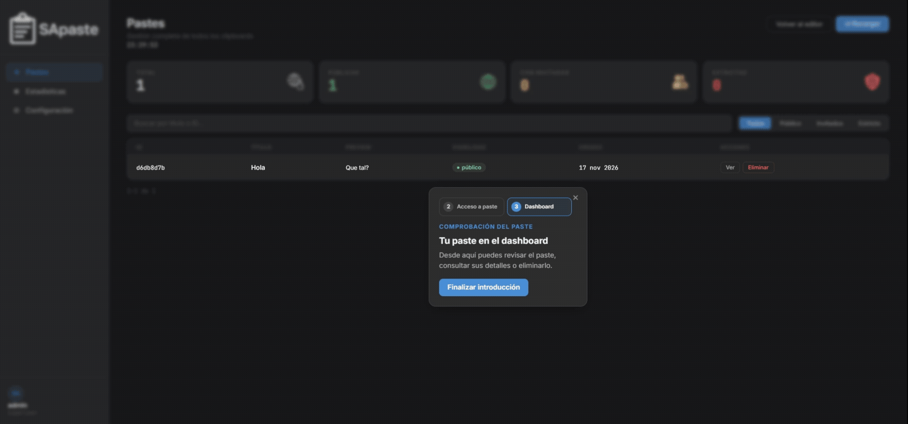

<div align="center">
  <picture>
    
  </picture>
  <br><br>
  <em>Interfaces web de SApaste para crear, compartir y administrar pastes.</em>
</div>

---

# Frontend web de SApaste

La carpeta `web` contiene las interfaces de usuario de **SApaste**, desarrolladas con **HTML, CSS y JavaScript vanilla**. No necesitan un proceso de compilación y se comunican con la API mediante peticiones HTTP.

## Tabla de contenidos

- [Aplicaciones](#aplicaciones)
- [Funciones principales](#funciones-principales)
- [Tecnologías y recursos](#tecnologías-y-recursos)
- [Estructura](#estructura)
- [Ejecución e integración](#ejecución-e-integración)

---

## Aplicaciones

### Cliente web

Ubicado en [`client web/`](client%20web/), es la interfaz para crear, editar, consultar y compartir pastes.

- Editor de texto enriquecido con formato, listas y alineación.
- Guardado y carga de pastes a través de la API; cada paste tiene una URL propia.
- Tres niveles de visibilidad: público, privado con invitados y privado estricto.
- Compartir enlaces, copiar la URL y consultar el historial de acciones.
- Temas claro y oscuro, contador de caracteres, estado de guardado y notificaciones.

<div align="center">
  
  <br>
  <sub><em>Editor, opciones de formato, visibilidad y acciones para compartir.</em></sub>
</div>

### Panel de administración

Ubicado en [`admin dashboard/`](admin%20dashboard/), permite a los administradores revisar y gestionar los pastes.

- Inicio de sesión y acceso a los datos protegidos mediante un token JWT.
- Listado paginado de pastes, búsqueda por título o ID y filtros por visibilidad.
- Resumen de cantidades por tipo de visibilidad.
- Consulta de detalles y eliminación de pastes con confirmación.
- Tema claro y oscuro.

<div align="center">
  
  <br>
  <sub><em>Panel de administración, estadísticas y gestión de pastes.</em></sub>
</div>

---

## Funciones principales

### Niveles de visibilidad

| Nivel | Ver | Editar |
|---|---|---|
| `publico` | Cualquiera | Cualquiera |
| `invitados` | Cualquiera | Con contraseña |
| `estricto` | Con contraseña | Con contraseña |

### Integración con la API

Ambas interfaces utilizan rutas relativas bajo `/api`, por lo que el servidor debe servir el frontend y dirigir esas rutas a la API. El cliente web utiliza los endpoints de pastes; el panel también utiliza los endpoints de administración.

El cliente envía la contraseña de un paste en la cabecera `X-Paste-Password`. El panel guarda el token de autenticación en `sessionStorage` durante la sesión y lo envía como `Authorization: Bearer ...`.

---

## Tecnologías y recursos

| Tecnología o recurso | Uso |
|---|---|
| HTML5 | Estructura de las páginas y editor `contenteditable` |
| CSS3 | Estilos adaptables y temas claro/oscuro |
| JavaScript vanilla | Interacción con la interfaz y peticiones a la API |
| DOMPurify | Sanitización del HTML cargado en el editor |
| Google Fonts | Tipografías del panel de administración |

Los logos, el favicon y los iconos para los distintos temas están en [`img/`](img/).

---

## Estructura

```text
web/
├── README.md
├── img/
│   ├── icons/
│   │   ├── dark/
│   │   ├── light/
│   │   └── shared/
│   ├── sapaste-icon.png
│   ├── sapaste-logo-dark.png
│   └── sapaste-logo-white.png
├── client web/
│   ├── index.html
│   ├── js/main.js
│   └── styles/style.css
└── admin dashboard/
    ├── index.html
    ├── js/main.js
    └── styles/style.css
```

---

## Ejecución e integración

1. Sirve los archivos de `web` desde un servidor HTTP, como Apache.
2. Configura el servidor para que las rutas `/api` lleguen a la API de SApaste.
3. Asegúrate de que las rutas del cliente que incluyen el identificador de un paste se resuelvan correctamente al `index.html` del cliente web.

No hay un paso de compilación. Para que las interfaces puedan cargar y guardar datos, la API debe estar disponible y el servidor debe enrutar correctamente las peticiones.